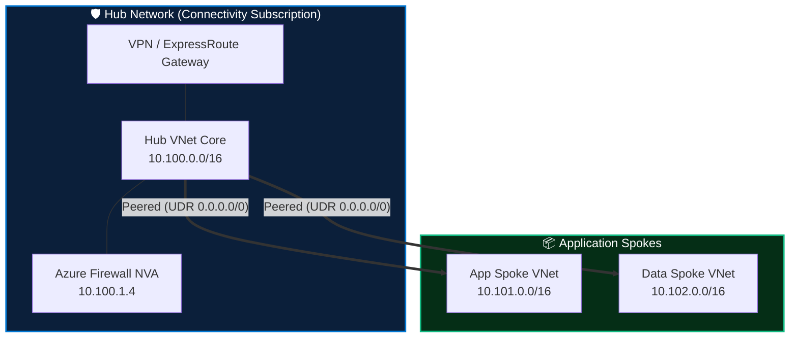

<div align="center">

# 🏛️ Enterprise Azure Landing Zones (CAF Architecture)

[](https://terraform.io)
[](#)
[](#)
[](#)

**Production-Grade Infrastructure as Code engineered with `for_each`, structured `map` types, and `dynamic` blocks for enterprise-scale multi-subscription environments.**

</div>

---

## 📌 Architectural Overview

This repository provides an enterprise-ready implementation of the **Microsoft Cloud Adoption Framework (CAF)** Azure Landing Zones. It enforces:

- 🛡️ **Zero-Trust Hub & Spoke Networking:** Centralized inspection via Azure Firewall NVA, User Defined Routes (UDR), and Private Link.
- ⚙️ **Modular Terraform Best Practices:** Zero hardcoded resources; 100% data-driven orchestration using `for_each` + `map(object)` schemas.
- 🔄 **Dynamic Block Optimization:** Seamless declaration of variable NSG security rules (`dynamic "security_rule"`) and route entries (`dynamic "route"`).
- 📜 **Shift-Left Security:** Automated CI/CD DevSecOps scanning via **TFLint**, **Checkov (CIS Azure Benchmark v2.0)**, and **Infracost**.



---

## 🏗️ Module Structure

```
.
├── main.tf                 # Root orchestration with for_each and VNet peerings
├── variables.tf            # Strongly-typed map and object declarations
├── outputs.tf              # Resource IDs, IP allocations, and topology maps
├── terraform.tfvars.example# Production template values
├── azure-pipelines.yml     # Multi-stage CI/CD pipeline with Checkov & TFLint
└── modules/
    ├── vnet/               # Virtual Network & Subnet factory (for_each)
    ├── nsg/                # Security Groups with dynamic "security_rule"
    └── route_table/        # UDR Route Tables with dynamic "route"
```

---

## 🚀 Quickstart

### 1. Prerequisites
- Terraform `>= 1.5.0`
- Azure CLI `>= 2.50.0`
- Azure Subscription with `Owner` or `Contributor` + `User Access Administrator`

### 2. Deployment

```bash
# Clone the repository
git clone https://github.com/Sujeetkumar122/azure-enterprise-landing-zones.git
cd azure-enterprise-landing-zones

# Configure variables
cp terraform.tfvars.example terraform.tfvars

# Initialize & Validate
terraform init
terraform validate

# Plan and Inspect
terraform plan -out=tfplan

# Apply
terraform apply tfplan
```

---

## 🔒 Security & Compliance

All modules are audited against the **CIS Microsoft Azure Foundation Benchmark v2.0**:
- Default-deny inbound NSG rules enforced on all workload subnets.
- Mandatory forced-tunneling via central Azure Firewall (`0.0.0.0/0` UDR).
- No public IPs assigned to workload network interfaces.
- Remote state secured in geo-redundant storage with Customer-Managed Keys (CMK).

---

## 👤 Author

**Sujeet Kumar**  
*Senior DevSecOps Engineer & Enterprise Cloud Architect (17+ Years Experience)*  
[](https://linkedin.com/in/sujeetkumar122)
[](https://github.com/Sujeetkumar122)
